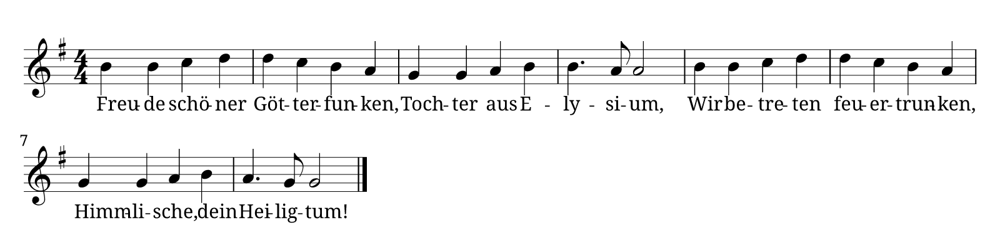

# Zahraj mi 🎵

**Snap a photo of sheet music, hear the melody and sing along.**
Everything runs in your browser – free, no sign-up, and your images stay on your device (the only exception is the optional [AI reading for invited people](#ai-reading-for-invited-people-optional)).

[](https://github.com/romanzdk/zahraj-mi/actions/workflows/ci.yml)
[](LICENSE)

👉 **Try it: [romanzdk.github.io/zahraj-mi](https://romanzdk.github.io/zahraj-mi/)**

> 🇨🇿 *Zahraj mi* je česky „zahraj mi“. Vyfoť noty ze zpěvníku, aplikace je přečte a zahraje melodii, do které můžeš zpívat.
> Můžeš zpomalit tempo, posunout tóninu podle svého hlasu, nechat si dát první tón nebo opakovat jen pár taktů. Přečtené písně si prohlížeč pamatuje i s nastavením, takže je příště pustíš bez focení.
> Vše běží přímo v prohlížeči, zdarma a bez registrace.



## Features

- 📷 **Photo or scan in, melody out.** Take a picture with your phone or upload an image (JPG, PNG). A MusicXML file works too.
- 🎹 **Made for singing.** Tempo slider, count-in, *starting note* button, loop a range of measures. Pick the sound: piano, flute, guitar, violin or organ.
- 🎚️ **Fits your voice.** Transpose by semitones or pick a voice type (bass, tenor, alto, soprano, child) and the melody moves into a comfortable range.
- 👀 **See what was read.** The recognized score is shown with a cursor that follows the music, so mistakes are easy to spot.
- 🗂️ **Your songs, remembered.** Every recognized song is saved in your browser with its tempo, key and other settings. Open it again from *My songs* without taking a new photo. Songs stay on this device only; clearing the site data removes them, and Safari on iPhone may clear them after a week without a visit unless the page is added to the Home Screen.
- 💾 **Take it with you.** Download the melody as MIDI (in your chosen key and tempo) or the score as MusicXML.
- 🔒 **Private by design.** Note recognition runs on your device. No account, no tracking of your images, and nothing is uploaded unless you use the optional AI reading below. Visits are counted with [GoatCounter](https://www.goatcounter.com/), without cookies.
- 🌍 Czech and English interface, light and dark mode, works on phones.

## How it works

```
photo ──► homr (optical music recognition, in a Web Worker) ──► MusicXML
                                                                   │
           OpenSheetMusicDisplay ◄── score view ◄──────────────────┤
                                                                   ▼
           Tone.js (instrument samples) ◄── melody line (top voice, ties merged)
```

1. **Recognition** – [homr](https://github.com/liebharc/homr) is an open-source optical music recognition (OMR) engine built for camera photos.
   This app uses [homr-web](https://github.com/jymen/homr-web), its port to the browser: the same ONNX models run on
   [onnxruntime-web](https://onnxruntime.ai/) with WebGPU where available and WebAssembly elsewhere.
   The models (about 100–160 MB) are downloaded once on first use and then cached by the browser.
2. **Melody extraction** – the MusicXML is reduced to a single singable line: the first part, its first voice and the top note of every chord, with tied notes merged.
3. **Playback** – [Tone.js](https://tonejs.github.io/) plays the line with recorded samples of a piano, flute, guitar, violin or organ (each loaded only when picked), and [OpenSheetMusicDisplay](https://opensheetmusicdisplay.org/) draws the score.

### Why not an AI service by default?

Recognition does not need a paid model: homr is free, open source and runs on the user's device.
That keeps the app free to run (static hosting only), fast after the first load and private.
Tests in CI run the real recognizer on a sample page (see [`e2e/app.spec.ts`](e2e/app.spec.ts)).
You can run the same check on your own photos: `REALWORLD_DIR=/path/to/photos npm run test:realworld` writes a report with the recognized notes and a screenshot of each score to `test-results/realworld/`.
On five real songbook photos (Czech Christmas songs, 430–1200 px wide) every page was read; on the two with hand-checked melodies all pitches matched. Rhythm and time signatures are less reliable on small, blurry images.

### Limitations

- Best results come from a **single melody line**, printed, photographed straight and sharp (like a songbook page).
- Handwritten music, very dense piano scores and low-light photos are often misread. Always check the shown score.
- Lyrics and chord symbols are not read; only the notes are played.
- Repeats are played once (no jumping back yet).
- The first recognition downloads the models; on mobile data that is a lot, Wi-Fi is recommended.

## AI reading for invited people (optional)

Some songbook photos are too small or blurry for homr. For those, invited people can let an AI model read the notes.
It runs through a small Cloudflare Worker ([`worker/`](worker/README.md)) that keeps the OpenRouter key, checks invite codes
and has a daily limit per person. The free in-browser recognition stays the default for everyone; without the Worker
configured, the site shows nothing about AI.

## Running locally

Requires Node.js 22+.

```bash
npm ci
npm run dev        # downloads and verifies the models into public/models, then starts Vite
```

Open <http://localhost:5173>. Other commands:

| Command | What it does |
|---|---|
| `npm test` | Unit tests (MusicXML parsing, voice fitting, MIDI export) |
| `npm run typecheck` | TypeScript check |
| `npm run models` | Download the recognition models (SHA-256 checked) into `public/models` |
| `npm run build` | Production build into `dist/` (run `npm run models` first) |
| `npm run test:e2e` | Browser tests with Playwright against the built site, including real recognition |
| `npm run make-demo` | Regenerate the demo song (`public/demo/`) |

The page needs [cross-origin isolation](https://web.dev/articles/coop-coep) for multi-threaded WebAssembly.
The dev and preview servers send the headers; on GitHub Pages [coi-serviceworker](https://github.com/gzuidhof/coi-serviceworker) adds them.
Because of that, every cross-origin script needs `crossorigin="anonymous"` (the GoatCounter one does, pinned with `integrity`).

## Deployment

Every push to `main` runs the tests, builds the site with the models and deploys it to GitHub Pages ([`.github/workflows/ci.yml`](.github/workflows/ci.yml)).
It is a static site, so any static host that allows files up to ~60 MB works.

## Contributing

Bug reports with a photo that was misread are very welcome – see [CONTRIBUTING.md](CONTRIBUTING.md).

## License

[AGPL-3.0](LICENSE), because the recognition engine (homr, homr-web) is AGPL-3.0.
Third-party components and their licenses are listed in [THIRD_PARTY_NOTICES.md](THIRD_PARTY_NOTICES.md).
The sound samples in `public/samples/` keep their own license (CC BY 3.0, see the notices), not the AGPL.
